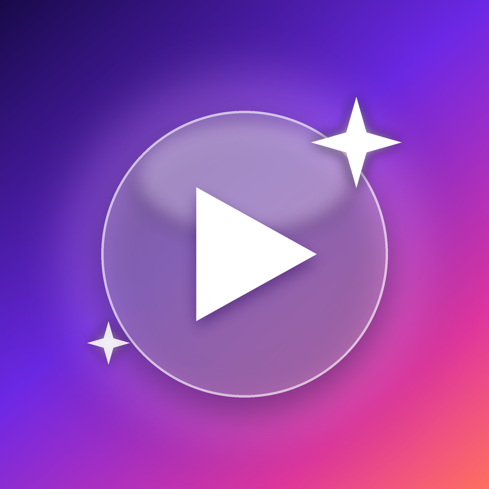

# NicePlay (ehemals NiceYT)

Ein nativer, werbefreier YouTube-Client **und Deezer-Musikplayer** für iOS 26+ im **Liquid-Glass-Design** – komplett in SwiftUI geschrieben, ohne Web-Views fürs Abspielen.

## Features

| | |
|---|---|
| 🎬 **Native Wiedergabe** | HLS-Streams direkt in AVKit (Liquid-Glass-Player von iOS 26), bis 4K, Geschwindigkeit, AirPlay |
| 🚫 **Werbefrei** | Werbe-Renderer und Werbeblöcke werden gar nicht erst geladen |
| 🔐 **Google-Login** | Anmeldung mit deinem Google-Konto (oder Cookie-Import als Alternative) |
| 📺 **Dein YouTube** | Startseite/Empfehlungen, Abo-Feed, abonnierte Kanäle, Verlauf, Später ansehen, Likes, Playlists |
| 👍 **Interaktion** | Liken/Disliken, Abonnieren, „Später ansehen“, Verlauf wird mitgeschrieben |
| ⚡ **Shorts** | Vertikaler Shorts-Feed mit Glas-Buttons |
| 💬 **Kommentare** | Inkl. Antworten und Sortierung (Top/Neueste) |
| 🔍 **Suche** | Vorschläge, Verlauf, Filter (Videos/Shorts/Kanäle/Playlists), YouTube-Links einfügen |
| 🎧 **Hintergrund & PiP** | Hintergrundwiedergabe, automatisches Bild-in-Bild, Sperrbildschirm-Steuerung |
| ⏭ **SponsorBlock** | Überspringt Sponsoren, Eigenwerbung, Intros … (einstellbar) |
| 👎 **Dislikes** | Über Return YouTube Dislike |
| 💬 **Untertitel** | Alle verfügbaren Spuren inkl. automatischer Untertitel |
| 🗣 **Originalton** | Immer die echte Tonspur – keine KI-Synchronisation von YouTube (umschaltbar pro Video) |
| 🎵 **Deezer** | Anmeldung per Deezer-Login oder ARL-Cookie, Suche, Alben, Künstler, Playlists, Lieblingssongs, Charts, Flow |
| 📥 **YouTube-Downloads** | Als Video (MP4, Qualität wählbar, offline im Player) oder nur Audio (M4A mit quadratischem Cover) |
| ⬇️ **Musik-Downloads** | MP3 320 oder FLAC inkl. Cover & Tags, offline hören, in jede App teilen, sichtbar in der Dateien-App |
| 📳 **Haptik & Long-Press** | Haptisches Feedback bei Likes, Abos, Gesten; langes Drücken öffnet überall weitere Aktionen (auch bei Shorts) |
| 🪟 **Liquid Glass** | Glas-Tabbar mit Mini-Player als Accessory, Glas-Chips, -Buttons und -Karten |

## IPA bauen (GitHub Actions)

Jeder Push auf `main` baut automatisch eine unsignierte `NiceYT.ipa` und veröffentlicht sie unter **Releases**.
Manuell: **Actions → Build NiceYT IPA → Run workflow**.

## Installieren

Die IPA ist unsigniert und wird beim Sideloaden mit deiner Apple-ID signiert:

- **AltStore / SideStore** – IPA in der App öffnen
- **Sideloadly** – IPA auf den Mac/PC ziehen, iPhone anschließen
- **TrollStore** – direkt installierbar (fake-signiert)

Voraussetzung: **iOS 26 oder neuer**.

## Deezer verbinden

Tab **Musik → Bei Deezer anmelden** und ganz normal einloggen – die App übernimmt den `arl`-Cookie automatisch.
Alternativ den `arl`-Cookie von deezer.com (Entwicklertools → Cookies) einfügen. Für 320 kbit/s bzw. FLAC
wird ein entsprechendes Deezer-Abo benötigt. Downloads liegen unter *Dateien → Auf meinem iPhone → NicePlay → Musik*.

## Anmeldung

Tippe auf **Mit Google anmelden** und melde dich ganz normal an. Die App speichert die YouTube-Sitzung im Schlüsselbund.
Falls Google die Anmeldung im eingebetteten Browser blockiert: **Einstellungen → Cookies importieren** und die Cookies von
`youtube.com` aus einem angemeldeten Browser einfügen (Cookie-Header oder `cookies.txt`).

## Alternative: Offizielle YouTube-App + YTLite

Der Workflow **Build YouTube Plus** baut die *offizielle* YouTube-App mit [YTLite](https://github.com/dayanch96/YTLite)
(werbefrei, Downloads, SponsorBlock, PiP, 4K, Dislikes) und schaltet das Liquid-Glass-Design frei.
Dafür brauchst du eine **entschlüsselte YouTube-IPA** (Direktlink), die du selbst besorgen musst.
Standard ist YTLite **5.2b4**, die letzte kostenlose Version. Das Ergebnis landet als Entwurf unter Releases.

## Technik

- `NiceYT/Core` – InnerTube-Client (WEB-Client für Feeds/Konto mit SAPISIDHASH, iOS-Client für HLS-Streams), robuster Renderer-Parser
- `NiceYT/Player` – AVKit-Player, Mini-Player, Shorts-Player, SponsorBlock, Untertitel, Now Playing
- `NiceYT/Views` – SwiftUI-Oberfläche mit iOS-26-Liquid-Glass-APIs (`glassEffect`, `GlassEffectContainer`, `tabViewBottomAccessory`, …)
- Projekt wird mit [XcodeGen](https://github.com/yonaskolb/XcodeGen) aus `project.yml` erzeugt

> NiceYT ist ein inoffizielles Projekt und steht in keiner Verbindung zu Google oder YouTube.
